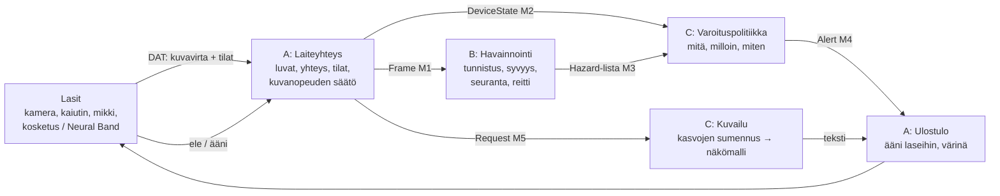

# Architecture

> Alustava suunnitelma. DAT:n todelliset rajat (videovirta, latenssi, ääni) varmistetaan Metan pisteellä, ks. `README.md`.

## Runtime shape

Kaikki turvavaroituksiin liittyvä tapahtuu **puhelimessa ilman verkkoa**. Pilveä käytetään vain pyydettyyn kuvailuun.



## Components

| Komponentti | Omistaja | Vastuu |
|---|---|---|
| Laiteyhteys | A | DAT-istunto, luvat, kuvavirta, lasien tilat (päässä / pois, kotelo, akku, BT-katko), kuvanopeuden säätö |
| Ulostulo | A | Puhe ja äänimerkit lasien kaiuttimeen, värinä puhelimessa/kellossa, jono ja keskeytys |
| Nauhoitus + toisto | A | Kehitystila: virta tallennetaan paikallisesti ja toistetaan putkeen kuin elävä virta |
| Havainnointi | B | Objektintunnistus, pään korkeuden esteet, karkea syvyys, seuranta kuvasta toiseen, "onko reitillä" |
| Arviointi | B | Merkitty aineisto, jako, `metrics.json`, latenssimittaus |
| Varoituspolitiikka | C | Priorisointi, vaimennus, epävarmuuden viestintä, "en näe" -tila, sanasto |
| Kuvailu + tietosuoja | C | Kasvojen sumennus, näkömallikutsu, välimuisti, offline-varapolku |
| Käyttäjätesti | C | Rata, protokolla, suostumuslomake, tulokset |

## Latenssibudjetti (tavoite p95 < 500 ms)

| Vaihe | Budjetti | Huom. |
|---|---|---|
| Lasien kamera → puhelin (DAT) | ~150 ms | **Tuntematon — varmista Metalta** |
| Tunnistus puhelimessa | ≤ 80 ms | Pieni malli (YOLO-luokka, CoreML / TFLite), 320–416 px |
| Syvyys + seuranta + reitti | ≤ 40 ms | Karkea; voi ajaa harvemmin kuin tunnistus |
| Varoituspolitiikka | ≤ 5 ms | Puhdas funktio |
| Puhe laseihin | ~150 ms | Valmiiksi syntetisoidut lyhyet sanat, ei TTS:ää lennosta |

Kävelyvauhti ~1,2 m/s → 500 ms = 60 cm. Varoitus pitää antaa vähintään 2 m ennen estettä.

## Havainnointi (B)

1. **Tunnistus:** valmiiksi opetettu pieni malli (COCO: ihminen, polkupyörä, auto, tuoli, penkki…) + hienosäätö omilla luokilla: pylväs/tolppa, ovi, portaat ylös/alas, pään korkeuden este. Pieni oma merkitty aineisto riittää hienosäätöön.
2. **Pään korkeus:** este, jonka alareuna on kuvassa horisontin yläpuolella ja joka kasvaa kohti keskikohtaa. Ei tarvitse metrisiä etäisyyksiä.
3. **Syvyys:** monokulaarinen syvyysmalli (pieni) tai laatikon koko + kasvunopeus → *lähellä / keskellä / kaukana* ja *lähestyy / ei*. Ei metrejä, jos ne eivät ole luotettavia.
4. **Reitti:** kuvan keskikaista ≈ kävelysuunta. Lasit liikkuvat pään mukana → tasoitus usean kuvan yli; kiihtyvyysanturi, jos DAT antaa sen.
5. **Seuranta:** sama este saa saman `track_id`:n kuvasta toiseen, jotta C voi vaimentaa toistot.

## Varoituspolitiikka (C)

- Varoitetaan vain, jos `in_path` ja (`proximity=near` tai `approaching`). Muuten hiljaa.
- Yksi varoitus kerrallaan, tärkein ensin: pään korkeus > portaat alas > ajoneuvo > pylväs > ihminen > ovi.
- Sama `track_id` vaimennetaan N sekunniksi, ellei se tule selvästi lähemmäs.
- Epävarmuus kerrotaan sanalla tai eri äänellä ("ehkä portaat"), ei piiloteta.
- `DeviceState` voittaa kaiken: kamera peitossa, pimeä, yhteys poikki → "en näe nyt" + värinä, toistetaan harvakseltaan.
- Kuvailu (näkömalli) ei koskaan keskeytä turvavaroitusta, ja turvavaroitus keskeyttää kuvailun.

## Tietosuoja ja suostumus

- Kuvat käsitellään muistissa, ei tallenneta. Nauhoitus vain kehitystilassa, tiimin omalla radalla, suostumuksella.
- Ennen kuin kuva lähtee puhelimesta (kuvailu), kasvot sumennetaan paikallisesti.
- Onboarding (äänellä): mitä sovellus tekee, mitä se ei tee, hiljaisuus ≠ vapaa reitti.

## Esitetty kansiorakenne (jos valitaan)

```
glasses/
  app/          A  mobiilisovellus (iOS tai Android, DAT)
  perception/   B  mallit, vienti CoreML/TFLite, arviointi
  policy/       C  varoituspolitiikka puhtaana logiikkana + testit
  describe/     C  kuvailu + kasvojen sumennus
  data/         B  merkityt klipit (ei kasvoja repoon)
```
